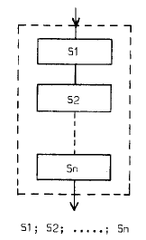
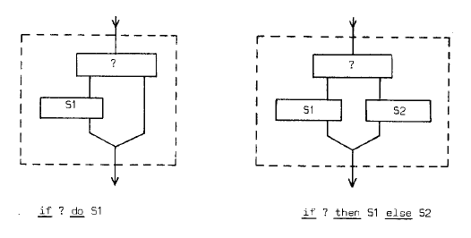
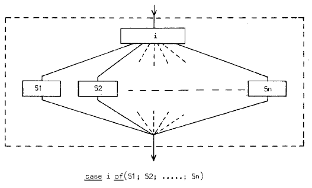
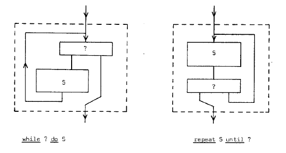

# 六、论理解程序

我一生中见过许多程序设计课程，本质上就像普通的驾驶课：教人如何操纵汽车，却不教人怎样用汽车到达目的地。

我的意思是，程序本身从来不是目的。程序的目的是引发计算过程，而计算的目的是产生预期效果。程序虽然是程序员制造的最终产品，但由它引发的可能计算过程——其“制造”留给机器！——才是这门职业真正的研究对象。例如，程序员声称程序正确时，实际上是在对它可能引发的计算过程作出断言。

整个活动的最后阶段，也就是从静态程序文本转到动态计算过程，基本上留给了机器，这又增加了复杂性。因此，在某种意义上，构造程序比构造数学理论更困难：程序与理论都是有结构、无时间性的对象；但数学理论本身就有意义，程序却只有通过执行才有意义。

本节余下部分只讨论为顺序机器编写的程序，并探索这样一种职责的后果：我们必须利用对程序的理解，对随之发生的计算过程作出断言。我的一个未经证明的主张是：能否方便、可靠地做到这一点，关键取决于二者关系是否简单，尤其取决于执行顺序控制的性质。笼统地说，我们希望程序文本的结构反映计算过程的结构。换个说法：“我们能做些什么，来缩短静态程序文本——分布在‘文本空间’中——与相应计算过程——在时间中展开——之间的概念距离？”

计算的目的是产生某种预期效果。它在离散时刻 t₀ 开始，在稍后的离散时刻 t₁ 完成；假定其效果可通过比较“t₀ 时的状态”与“t₁ 时的状态”来描述。不考虑任何中间状态时，我们把这一效果看作由一个原子动作产生。

若考虑若干中间状态，就意味着我们把时间中发生的事情划分开来，把它视为一个顺序计算过程，即若干子动作在时间上的依次发生。我们必须确信，这些子动作依次发生所累积的效果，确实等于整个计算所期望的净效果。

## 6.1 顺序连接、选择与重复

最简单的情形，是分解成固定数量、可以列举的子动作。流程图如下：



必须用枚举推理来确立这种分解的有效性。此时，若要求一段线性的程序文本按照动作应当发生的次序，包含这些子动作的名称或描述，就可以缩短程序与计算过程之间的概念距离。此前保持 `0 ≤ r < dd` 不变的例子满足这一条件：

```text
dd ≔ dd / 2;
if dd ≤ r do r ≔ r - dd
```

计算的第一层分解，是两个动作依次发生。我们在程序文本中识别出这一结构：

```text
将 dd 减半;
将 r 化为模 dd 的余数
```

我们考虑所有满足 `0 ≤ r < dd` 的初始状态；对于由此考虑的全部计算过程，这种两子动作的划分都适用。到这里，一切都好。

不过，编写此程序时假定：“将 r 化为模 dd 的余数”不是原子动作，而“从 r 中减去 dd”是原子动作。查看前一个动作内部可能发生的事情，就必须区分：有些情况下执行减法，另一些情况下 r 保持不变。写成：

```text
if dd ≤ r do 从 r 中减去 dd
```

就表示：在这一细节层次上，求余动作可采取两种互斥形式之一，同时给出了选择的判据。若把 `if dd ≤ r do` 看作附加于减法动作的条件子句，那么把条件放在被控制语句之前就是自然的。在这个意义上，以下二选一子句对于两个分支语句而言，是“过度排序”的：

```text
if 条件 then 语句1 else 语句2
```

它们只是两种备选形式，在一个线性媒介中无法同时表达而不分先后。

C. A. R. Hoare 把二选一子句推广为 `case-of` 构造，允许从两个以上的可能项中选择。流程图如下：





这些流程图都有顶部的单一入口与底部的单一出口。正如虚线框所示，忽略内部细节，它们又可解释为顺序计算过程中的一个动作。更精确地说，我们处理大量可能的计算过程，首先把它们都分解为同样的子动作序列；只有进一步查看虚线框内部，才发现同一个子动作，在整个计算过程集合中可能采取列举出的若干不同形式之一。

上面的结构足以处理首先分解为同一组可列举子动作的一类计算过程，却不足以处理子动作数量随具体计算而变化的一类计算。重复子句的用处在这里显现。`while 条件 do 语句` 与 `repeat 语句 until 条件` 的流程图如下：



它们也有顶部的单一入口和底部的单一出口，能表达：进一步观察时，虚线框中的动作由某类子动作依次发生“足够多次”构成。

至此，我们看到三种分解，可分别称为“顺序连接”“选择”“重复”。前两种用枚举推理理解，最后一种用数学归纳法理解。

仅使用选择子句和重复子句控制执行顺序的程序，可以直接翻译成另一种语言：该语言其余方面相同，只是必须用跳往带标号位置的跳转来表达顺序控制。反过来却不成立。换句话说，若只使用上述三种分解，所得流程图的拓扑结构受到限制；若允许从任何块画箭头到任何其他块，就有更大的自由。相对于这种自由，把自己限制在这些子句内，就是一种执行顺序纪律。

## 6.2 为什么遵守这种纪律

为什么我主张遵守这一纪律？其理由可以有多种表述。让我试着给出几种，希望其中至少一种能打动读者。

我们的一个最终目标，是构造结构良好的程序，使理解它所需的智力投入——以某种宽泛尺度衡量——与程序长度——同样以某种宽泛尺度衡量——成正比。尤其要防止枚举推理的需求爆炸。这迫使我们应用“分而治之”的古老原则，也是我们主张逐步分解计算过程的原因。

对于顺序连接式分解，我们可以用枚举推理理解，前提是第一层子动作数量足够少，而且对它们净效果的规定足够简洁。以后我会再谈这些要求，目前假定已满足。由于计算过程中的推进与程序文本中的推进，二者关系十分直接，因此根据程序文本对计算过程作出断言是可行的。

尤其是，进一步查看时，某一子动作若由选择或重复子句控制，这并不会增加理解第一层分解的负担，因为在那里只需考虑这一子动作的净效果。

由此可得：若子动作内部由选择子句控制，那么在第一层中，具体走哪条路径始终无关紧要，重要的只是走了正确的路径。同样，若内部由重复子句控制，循环体究竟执行多少次，本身也无关紧要，重要的只是执行了正确的次数。

选择子句本身可以用枚举推理理解，重复子句本身可以用数学归纳法理解。对这三种分解，我们都知道相应的推理模式；在我看来，这帮助很大。

## 6.3 描述计算进展的坐标

这种执行顺序纪律还有一个好处。理解程序时，我们建立关系。例如，在枚举推理的例子中，我们证明：

```text
dd ≔ dd / 2;
if dd ≤ r do r ≔ r - dd
```

保持 `0 ≤ r < dd` 不变。然而，即使能保证这段程序执行前关系成立，也不能断言它始终成立，尤其不保证在两条语句之间成立。换句话说，关系的有效性取决于计算推进到什么位置；这似乎是顺序过程的典型特征。

类似地，我们赋予变量某种含义。例如，一个变量记录某类事件发生的次数，如当前页上已经打印的行数。转到下一页后，立即把计数清零；打印一行后，立即加一。恰在清零或加一之前，“当前页已经打印的行数”这一解释并不有效。可见，赋予变量含义，同样只能相对于计算进展来做。这引出一个问题：“如何刻画计算过程的进展？”

我们要寻找一个坐标系，用它识别计算进展中的离散位置；还希望这个坐标系独立于程序所操纵的变量。如果需要这些变量的值才能描述计算进展，就陷入循环论证，因为我们恰恰希望相对于这一进展来解释变量的含义。

还有更严格的理由：一个永不结束的循环，可能在有限个不同状态间循环。之所以永远循环，就是因为在**不同**的进展位置，出现了**相同**的状态。此时，状态显然无法区分这两个不同的进展位置！

也可以这样提出问题：程序正在运行，计算尚未完成便在某个离散进展位置被停止。怎样识别中断点，例如为了重新计算到完全相同的位置？或者，若停止是某种运行时错误造成的，怎样在不做完整内存转储的情况下，识别计算推进到了哪里？

为简单起见，假定程序文本铺在一维文本空间中，并有一种机制，可标识与计算的离散进展位置对应的程序位置。称它为“文本索引”。如果进展位置位于相邻语句执行之间，文本索引就可以标识分号。它是一种广义的指令计数器，其值指向文本中的某一处。

若只采用顺序连接与选择分解，单个文本索引足以标识计算进展。加入重复子句后，仅有文本索引便不够了。不过，每次进入重复子句，系统可以引入一个“动态索引”，持续记录当前是该循环的第几次迭代；循环终止时，再删除它。

重复子句可以嵌套，因此合适的机制是栈，即后进先出的存储结构。开始时栈为空；进入重复子句时，在栈顶加入新的动态索引，初值为零或一；每当决定循环尚未终止，就将栈顶元素加一；每当决定循环终止，就移去栈顶元素。这一安排清楚反映：循环结束后，执行过多少次，乃至它曾经是一个循环这一事实，都不再相关。

一旦语言允许过程，单个文本索引又不够了。当索引指向过程体内部时，只有同时说明指的是哪一次过程调用，才能刻画计算的动态进展。这可以通过给出指向调用位置的文本索引来做到。因此，加入过程后，文本索引必须推广为一个文本索引栈：调用时增加一个元素，返回时减少一个元素。

关键在于，这些索引的值不受程序员控制；无论他愿意与否，它们都由程序文本或当前计算的动态展开所决定。它们提供独立坐标，用来描述计算进展；也提供一个“独立于变量”的参照系，以便赋予变量含义。

当然，即使允许自由跳转，仍有一个不依赖程序员的坐标系，能唯一描述顺序计算的进展：一种标准化时钟，记录自程序开始以来经过了多少个“离散进展位置”。它确实唯一，却完全不便使用，因为文本索引不再是这个坐标系的组成部分。

由此得到的教训是：如果承认有义务通过引发计算的程序文本，在智力上掌握这些计算过程，那么我们就应谦逊地限于最有系统性的执行顺序机制，保证“计算过程中的推进”尽可能直接地映射到“文本中的推进”。
